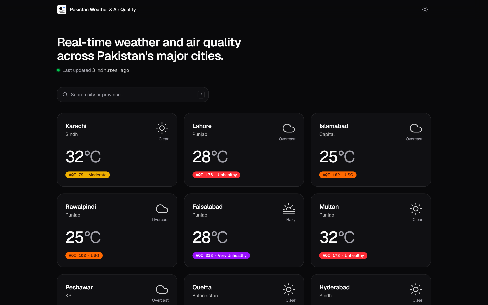
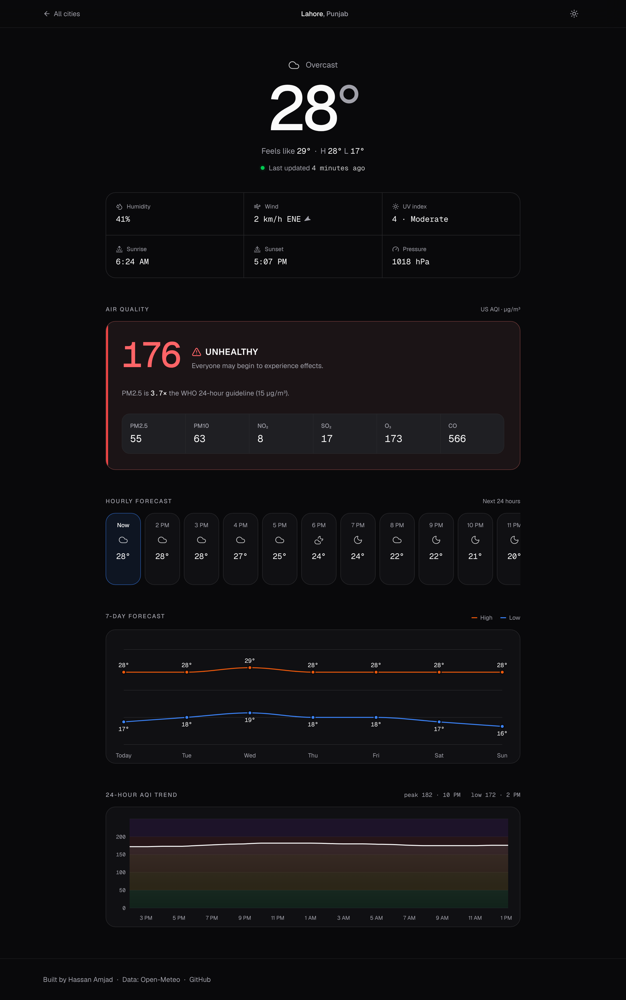
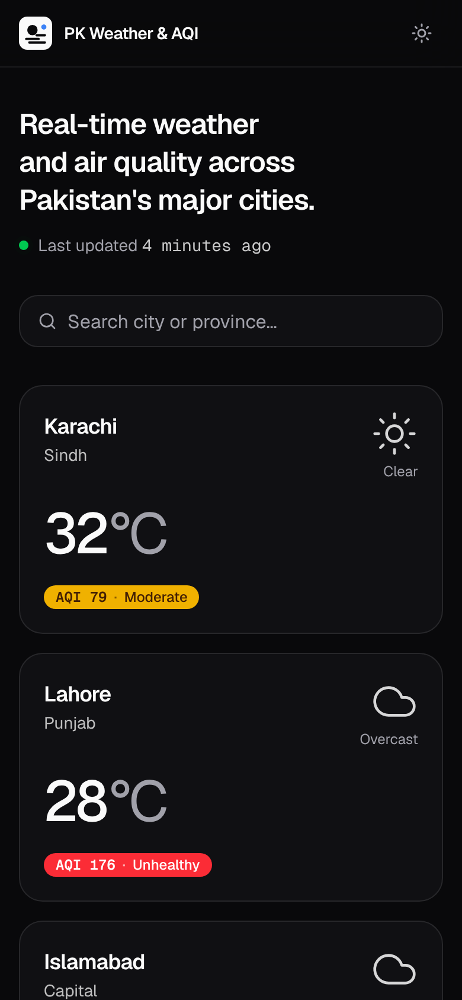
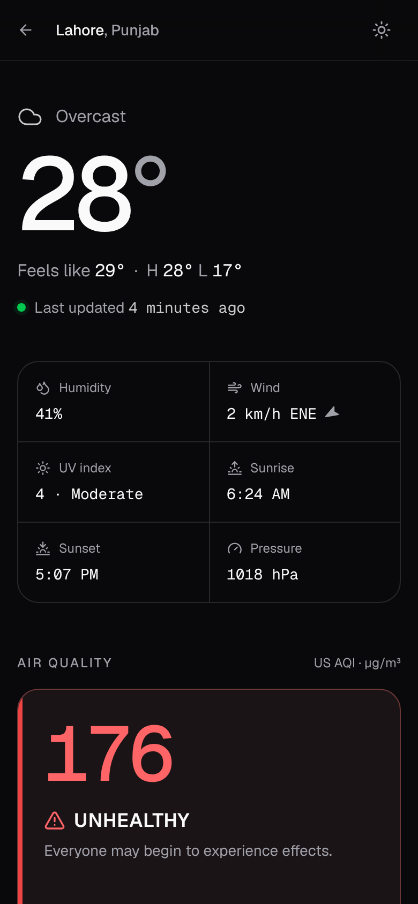

# Pakistan Weather & Air Quality Dashboard

A real-time weather and AQI dashboard for Pakistan's 11 major cities.

🔗 **Live:** https://pakistan-weather-aqi.vercel.app



## Screenshots

**City detail:** current conditions, pollutant breakdown, hourly and
7-day forecast, and the 24-hour AQI trend.



**Mobile**

<p>
  
  &nbsp;
  
</p>

## Why

Pakistan's existing air quality platforms are hard to use and visually
dated. Lahore consistently ranks among the world's most polluted cities.
This project delivers the same data in an interface that doesn't make
people avoid checking.

## Features

- Live weather and AQI for 11 cities
- 7-day weather forecast and 24-hour AQI trend charts
- Pollutant breakdown (PM2.5, PM10, NO₂, SO₂, O₃, CO)
- Hourly forecast strip for the next 24 hours
- Live updates: open pages pick up new data without a reload
- Dark and light mode
- Fully responsive, mobile-first

## Tech

Next.js 15 · TypeScript · Tailwind CSS v4 · shadcn/ui · Recharts ·
Framer Motion · Supabase (Postgres cache) · Vercel (hosting) ·
Open-Meteo (data source)

## Architecture

A scheduled job hits `/api/refresh` every 15 minutes. That route fetches
weather and AQI from Open-Meteo for every city (two batched requests),
upserts the results into a single Supabase table, and revalidates the
affected pages on demand. Pages read from Supabase using React Server
Components with ISR (`revalidate = 300`), so users never wait on the
upstream API and the site stays well under Open-Meteo's fair-use
guidelines. If Open-Meteo is down, nothing is overwritten and the site
keeps serving the last good data.

Open pages update live. After each refresh the route broadcasts on a
Supabase Realtime channel, and every open tab re-renders its server
components in place (`router.refresh()`), so new readings appear without
a reload and scroll position and search text are kept.

```
cron ──► /api/refresh ──► Open-Meteo (weather + air quality)
                │
                └──► Supabase city_data (JSONB cache) ◄── pages (RSC + ISR)
```

## Run locally

```bash
git clone https://github.com/HassanAmjad7543/pakistan-weather-aqi.git
cd pakistan-weather-aqi
pnpm install
cp .env.example .env.local   # set CRON_SECRET at minimum
pnpm dev
```

Load data once:

```bash
curl -H "Authorization: Bearer $CRON_SECRET" http://localhost:3000/api/refresh
```

Without Supabase variables, the app caches to `.data/city_data.json`, so
you can develop with no database at all. Add the three Supabase variables
to use Postgres instead.

## Deploy

1. **Supabase:** create a project and run [`supabase/schema.sql`](supabase/schema.sql)
   in the SQL editor. It creates the table, enables RLS and allows public
   read-only access.
2. **Vercel:** import the repo and add `NEXT_PUBLIC_SUPABASE_URL`,
   `NEXT_PUBLIC_SUPABASE_ANON_KEY`, `SUPABASE_SERVICE_ROLE_KEY` and
   `CRON_SECRET` to the project's environment variables.
3. **Cron:** Vercel's Hobby plan only allows daily cron jobs, so use
   [cron-job.org](https://cron-job.org) (free) for the 15-minute schedule:
   - URL: `https://pakistan-weather-aqi.vercel.app/api/refresh`
   - Schedule: every 15 minutes
   - Header: `Authorization: Bearer <CRON_SECRET>`

   On Vercel Pro you can instead add a `vercel.json` with
   `{"crons":[{"path":"/api/refresh","schedule":"*/15 * * * *"}]}`. Vercel
   sends the `CRON_SECRET` bearer header automatically.
4. Trigger the first refresh by hand (curl above, against the live URL).

## API

| Route | Description |
| --- | --- |
| `GET /api/refresh` | Cron endpoint. Requires `Authorization: Bearer <CRON_SECRET>`. |
| `GET /api/cities/[slug]` | Cached JSON for one city, e.g. `/api/cities/lahore`. |

## Credits

Weather and AQI data from [Open-Meteo](https://open-meteo.com) (free, open-source).
